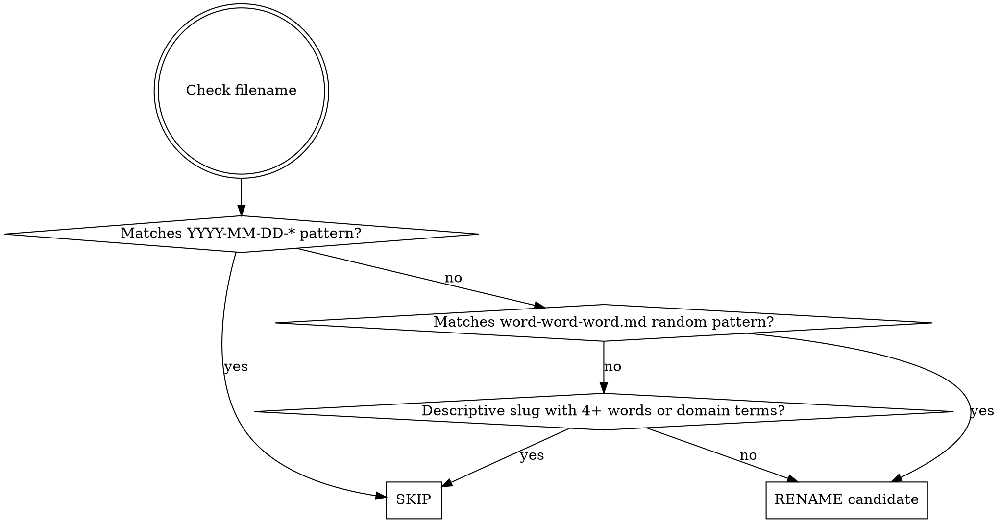

# Plan File Cleaner

Organize plan/spec/review `.md` files: rename important project-specific documents to `{YYYY-MM-DD}-{feature}-{type}.md`, and offer to delete trivial or unrelated ones.

**Resource note:** This task is simple file operations — use haiku model or dispatch a haiku subagent.

## Steps

### 1. Discover files

List `.md` files in these directories (if they exist):
- `docs/plans/`
- `docs/superpowers/plans/`
- `docs/superpowers/specs/`

### 2. Classify: rename or skip?



Examples:
- `vivid-discovering-papert.md` -> RENAME (random three-word)
- `annotation-data-quality-evaluation.md` -> SKIP (descriptive domain slug)
- `2026-03-10-batch-export-plan.md` -> SKIP (already dated)
- `2026-03-10-auth-redesign-design.md` -> SKIP (already dated, specs dir)

### 3. Read each candidate and triage

For each rename candidate, read its content and classify it into one of two buckets:

#### RENAME — important, project-specific documents

Documents that describe meaningful feature work, architectural decisions, or domain-specific plans worth preserving. Extract metadata:

- **feature**: Main topic in 2-4 kebab-case words (e.g., `batch-export`, `dev-report-todos`)
- **type**: One of `plan`, `review`, `spec`, `design` — infer from:
  - Parent directory name (`specs/` -> `spec`, `plans/` -> `plan`)
  - H1 heading (e.g., "# Plan: ..." -> `plan`)
  - Content keywords ("review", "evaluation", "specification")
  - Existing suffix (e.g., `*-design.md` -> `design`)
  - Default to `plan` if ambiguous

#### DELETE — trivial or unrelated documents

Offer deletion for documents that match any of these criteria:

- **Chore/tooling meta-plans**: Plans about configuring tools, skills, CI tweaks, linter setup — not about the project's own features (e.g., a plan to create or update a Claude skill)
- **Minor fixes**: Small bug fixes, typo corrections, config adjustments that don't warrant a persistent plan document
- **Already completed one-off tasks**: Documents describing work that has already been done and whose content has no ongoing reference value
- **Generic/boilerplate**: Documents with little substantive content or that duplicate information available elsewhere (README, CLAUDE.md, git history)

When in doubt, lean toward RENAME — only suggest deletion when the document is clearly low-value.

### 4. Determine date

Use **git creation date first**, fall back to file mtime:

```bash
# Git first-commit date for the file
git log --diff-filter=A --follow --format="%as" -- "PATH" | tail -1

# Fallback: file modification time
stat -c '%y' PATH | cut -d' ' -f1
```

**Do NOT use today's date** unless both methods fail.

### 5. Present confirmation table

**Always show both tables (if applicable) and wait for user confirmation before acting:**

```
Proposed renames (important project documents):
| Current                         | New                                    |
|---------------------------------|----------------------------------------|
| vivid-discovering-papert.md     | 2026-03-20-batch-export-plan.md        |

Proposed deletions (trivial/unrelated):
| File                            | Reason                                 |
|---------------------------------|----------------------------------------|
| drifting-stargazing-flurry.md   | Tooling meta-plan (skill configuration)|

Proceed? (Waiting for your confirmation)
```

Use AskUserQuestion to get explicit approval. Present a single question with options:
- "Rename and delete as proposed"
- "Rename only, skip deletions"
- "Skip all"

### 6. Execute actions

**Renames** — for each approved rename:

```bash
# Check if tracked
git ls-files --error-unmatch PATH 2>/dev/null

# Tracked: git mv (preserves history)
git mv OLD NEW

# Untracked: plain mv
mv OLD NEW
```

**Deletions** — for each approved deletion:

```bash
# Check if tracked
git ls-files --error-unmatch PATH 2>/dev/null

# Tracked: git rm
git rm PATH

# Untracked: plain rm
rm PATH
```

Report each action. Continue on individual failures.
