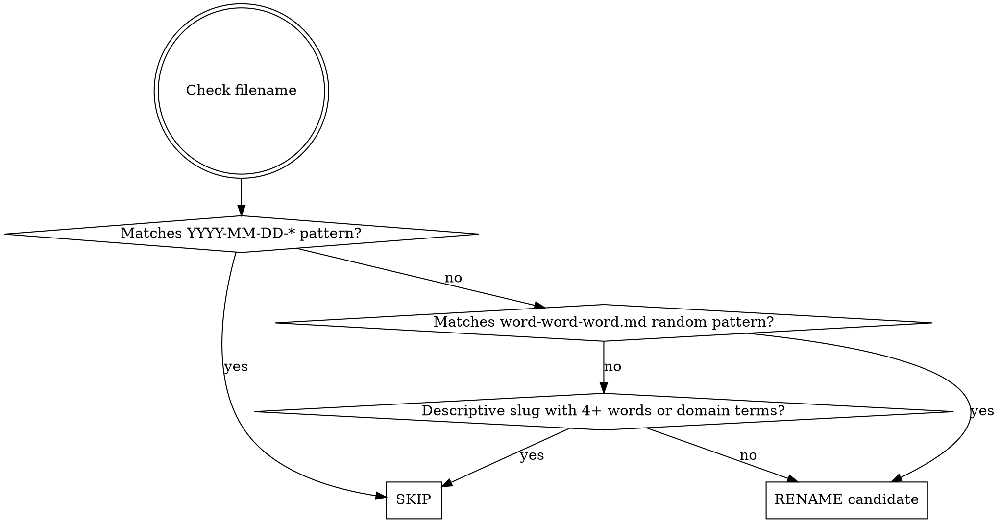

# Plan File Cleaner

Organize plan/spec/review `.md` files: rename important project-specific documents to the dated names below, and offer to delete trivial or unrelated ones.

| Type | New name |
|---|---|
| `plan` | `{YYYY-MM-DD}-{feature}.md` — no suffix |
| `spec` | `{YYYY-MM-DD}-{feature}-spec.md` |
| `review` | `{YYYY-MM-DD}-{feature}-review.md` |

These match the global layout rules (`~/.claude/rules/docs-layout.md`). A plan has no `-plan` suffix.

The per-file classification in step 3 fans out to parallel Haiku subagents — independent rubric-driven extraction with no shared state. The main session handles discovery, approval, and execution.

## Steps

### 1. Discover files

List the `.md` files in `docs/plans/`. Skip `README.md`, which is an index, not a plan.

Superpowers' default folders (`docs/superpowers/plans/`, `docs/superpowers/specs/`) are not scanned. The global instructions send all plans and specs to `docs/plans/`.

### 2. Classify: rename or skip?



Examples:
- `vivid-discovering-papert.md` -> RENAME (random three-word)
- `annotation-data-quality-evaluation.md` -> SKIP (descriptive domain slug)
- `2026-03-10-batch-export.md` -> SKIP (already dated)
- `2026-03-10-auth-redesign-spec.md` -> SKIP (already dated)

### 3. Triage each candidate (dispatched in parallel)

Each candidate is triaged into one of two buckets, with metadata extraction for the rename bucket. The criteria below are the rubric — they apply identically whether you triage inline or via dispatch.

#### RENAME — important, project-specific documents

Documents that describe meaningful feature work, architectural decisions, or domain-specific plans worth preserving. Extract metadata:

- **feature**: Main topic in 2-4 kebab-case words (e.g., `batch-export`, `dev-report-todos`)
- **type**: One of `plan`, `review`, `spec` — infer from:
  - H1 heading (e.g., "# Plan: ..." -> `plan`)
  - Content keywords ("review", "evaluation", "specification", "design")
  - Existing suffix (e.g., `*-spec.md` or `*-design.md` -> `spec`)
  - Default to `plan` if ambiguous

#### DELETE — trivial or unrelated documents

Offer deletion for documents that match any of these criteria:

- **Chore/tooling meta-plans**: Plans about configuring tools, skills, CI tweaks, linter setup — not about the project's own features (e.g., a plan to create or update a Claude skill)
- **Minor fixes**: Small bug fixes, typo corrections, config adjustments that don't warrant a persistent plan document
- **Already completed one-off tasks**: Documents describing work that has already been done and whose content has no ongoing reference value
- **Generic/boilerplate**: Documents with little substantive content or that duplicate information available elsewhere (README, CLAUDE.md, git history)

When in doubt, lean toward RENAME — only suggest deletion when the document is clearly low-value.

#### Dispatch

Reading and classifying each file is independent work that benefits from cheaper-model parallelism. With **3 or more candidates**, fan out via the Agent tool — one call per file, all dispatched in a **single message** so they run concurrently. Use `subagent_type: "general-purpose"` and `model: "haiku"`. With 1–2 candidates, classify inline; spawn overhead exceeds the savings.

Each subagent gets this self-contained prompt (substitute `<PATH>` for the candidate's path):

```
Classify the plan/spec/review file at <PATH>.

Read the file in full, then return ONE JSON object on a single line, no prose, no code fences:
{"path": "<PATH>", "decision": "RENAME"|"DELETE", "feature": "<kebab-case-2-to-4-words>"|null, "type": "plan"|"review"|"spec"|null, "reason": "<one short sentence>"}

Decision rules:

RENAME — important, project-specific documents describing meaningful feature work,
architectural decisions, or domain-specific plans worth preserving. For RENAME,
populate feature and type:
- feature: 2-4 kebab-case words for the main topic (e.g. "batch-export")
- type: one of plan/review/spec — infer from the H1 heading
  ("# Plan: ..." -> plan), content keywords (review, evaluation,
  specification, design), existing suffix (*-spec.md or *-design.md -> spec);
  default to "plan" if ambiguous.

DELETE — trivial or unrelated documents matching any of:
- Chore/tooling meta-plans (configuring tools, skills, CI tweaks, linter setup —
  not the project's own features)
- Minor fixes (small bug fixes, typo corrections, config adjustments that don't
  warrant a persistent plan)
- Already completed one-off tasks with no ongoing reference value
- Generic/boilerplate (little substantive content, or duplicates README,
  CLAUDE.md, or git history)

For DELETE, set feature and type to null. The reason field is required for both
buckets — for DELETE explain which criterion it matched; for RENAME give a brief
justification.

When in doubt, lean RENAME — only choose DELETE when the document is clearly
low-value.
```

Aggregate the returned JSON rows into a single in-memory list keyed by path before moving to step 4. If any subagent returns malformed JSON or fails, classify that one file inline rather than retrying — one bad row shouldn't block the rest.

### 4. Determine date

Use **git creation date first**, fall back to file mtime:

```bash
# Git first-commit date for the file
git log --diff-filter=A --follow --format="%as" -- "PATH" | tail -1

# Fallback: file modification time
stat -c '%y' PATH | cut -d' ' -f1
```

**Do NOT use today's date** unless both methods fail.

### 5. Present confirmation table

**Always show both tables (if applicable) and wait for user confirmation before acting:**

```
Proposed renames (important project documents):
| Current                         | New                                    |
|---------------------------------|----------------------------------------|
| vivid-discovering-papert.md     | 2026-03-20-batch-export.md             |

Proposed deletions (trivial/unrelated):
| File                            | Reason                                 |
|---------------------------------|----------------------------------------|
| drifting-stargazing-flurry.md   | Tooling meta-plan (skill configuration)|

Proceed? (Waiting for your confirmation)
```

Use AskUserQuestion to get explicit approval. Present a single question with options:
- "Rename and delete as proposed"
- "Rename only, skip deletions"
- "Skip all"

### 6. Execute actions

**Renames** — for each approved rename:

```bash
# Check if tracked
git ls-files --error-unmatch PATH 2>/dev/null

# Tracked: git mv (preserves history)
git mv OLD NEW

# Untracked: plain mv
mv OLD NEW
```

**Deletions** — for each approved deletion:

```bash
# Check if tracked
git ls-files --error-unmatch PATH 2>/dev/null

# Tracked: git rm
git rm PATH

# Untracked: plain rm
rm PATH
```

Report each action. Continue on individual failures.
